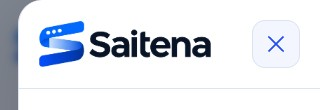
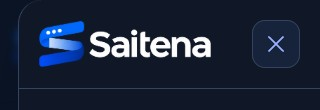
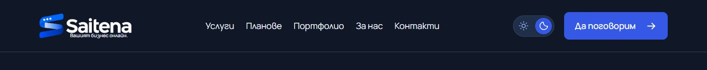
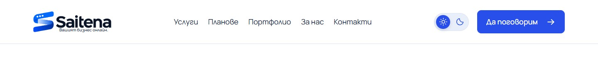
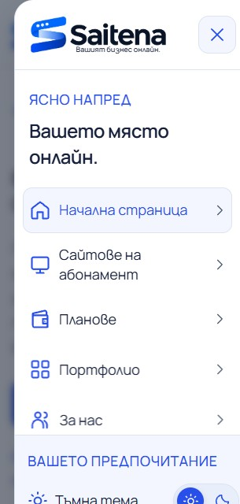

# Saitena — лого за светла и тъмна тема

## Файлове и произход

Предоставени референции: `Saitena Blue Ribbon Logo.png` и `Saitena Dark Mode Logo.png` от Downloads. Оригиналните файлове не са променяни.

С вградения imagegen е подготвен прозрачен master от светлия вариант. Опитите за автоматично извличане на белия надпис дадоха артефакти и не се използват в проекта. Тъмният вариант използва същия чист контур на master изображението и бял надпис чрез SVG color matrix, приложена само върху буквите; синята лента и нейните бели точки се запазват.

| Активен файл | Предназначение |
| --- | --- |
| `public/brand/saitena-logo-light.svg` | Пълно лого с тъмен надпис за светлата тема |
| `public/brand/saitena-logo-dark.svg` | Пълно лого с бял надпис за тъмната тема |
| `public/brand/saitena-mark.svg` | Самостоятелна синя лента за favicon и декоративен watermark |
| `public/brand/saitena-logo-master.png` | Прозрачен PNG master с оригиналните пиксели от избрания imagegen резултат |

SVG файловете са самостоятелни контейнери с вграден растерен PNG, не векторно прерисуване на логото. ViewBox изрязва празните полета от всички страни с около 2 px предпазен отстъп. Видимият размер на пълните варианти е 1957 × 525, а на знака — 525 × 525. PNG master е пакетиран без загуби; сравнение на декодираните RGBA стойности потвърждава, че пикселите не са променени при оптимизацията.

## Използване

`src/components/brand.tsx` предоставя общия `Brand` компонент за хедъра, мобилния sidebar и футъра. Линкът има достъпно име „Saitena — начало“. CSS избира изображението по `html[data-theme]` още при първото изобразяване, без отделен клиентски state и без промяна на геометрията при превключване.

Логото е 188 px широко в desktop хедъра, 172/145 px на телефон, 192/172 px в sidebar и 208 px във футъра. Изображенията запазват пропорциите си. Старата временна текстова марка и знак не се изобразяват на тези места. Favicon използва синята лента и е подходящ за двете теми.

## Imagegen prompt

Използван е вграденият tool, без CLI или API key. Финалният prompt за избрания master:

> Use case: background-extraction. Edit target: the supplied Saitena logo image. Create a production website asset by removing ONLY the entire flat white background, including the enclosed spaces/counters between letters and around the ribbon. Keep the existing logo EXACTLY unchanged: blue folded ribbon S with its three white dots, original gradients, exact shape and typography, exact text "Saitena", and original dark navy wordmark. Do not redesign, trace in a different style, recolor, add shadows, change the lettering, or add anything. Preserve white dots and the light blue ribbon segment as opaque logo artwork. Output actual transparent alpha, not a checkerboard. Crop the canvas tightly to the complete horizontal ribbon plus wordmark on all four sides, with only a tiny 2–4 pixel transparent safety margin and no cut-off edges. Maintain the original wide logo proportions, approximately 3.85:1, and the original gap between symbol and wordmark. Crisp antialiased edges, no background color fringe or halo. Single standalone logo only.

Проектните файлове са копирани в `public/brand`; сайтът не зависи от Downloads или `.codex/generated_images`.

## Проверка

PNG има реален alpha канал и прозрачен ъгъл. `npm run build` и `npm run typecheck` са успешни. HTTP проверка на началната, контактите и FAQ потвърди общото лого в хедъра, sidebar и футъра и правилната favicon връзка. Трите SVG файла се сервират с HTTP 200 и `image/svg+xml`.

Декодиране на двата SVG варианта потвърди еднакъв alpha канал, еднакви пиксели на синята лента и прозрачни ъгли. Цветът се променя само върху надписа.

В Chrome е проверено автоматичното показване на правилния файл във всички общи позиции при светла/тъмна тема. Всички изображения са заредени успешно, с правилно съотношение на страните. При desktop 1440 px и мобилно меню 320 px няма хоризонтално преливане. След проверката са възстановени първоначалната тема и нормалният viewport; сайтът остава отворен и работи локално.

Няма deployment или промени по замразената хостинг платформа. Това е визуална проверка в Chrome, не пълна cross-browser сертификация.

## Слоган в хедъра

Опцията `withTagline` на `Brand` добавя жив текст „Вашият бизнес онлайн.“ под буквите на Saitena. Активна е в хедъра и мобилното меню. Слоганът използва цвета `--ink` на текущата тема и се мащабира спрямо ширината на логото чрез container units. Заема свободната долна част на изображението, от 29.28% от ширината му, без да увеличава височината на логото. Футърът запазва досегашния вариант.

Рамката отдолу е върху външния `.site-header`, по цялата ширина на страницата. Вътрешният `.header-inner.wrap` запазва съществуващите отстъпи и максимална ширина 1280 px.

След промяната `npm run build` и `npm run typecheck` са успешни. В Chrome са проверени светла и тъмна тема, desktop 1440 px и мобилна ширина 320 px, включително sidebar. Няма хоризонтално преливане. При възстановения viewport разделителят е 1920 px, а вътрешният контейнер остава 1280 px. Първоначалната тъмна тема и нормалният viewport са възстановени; локалният сайт остава отворен.

