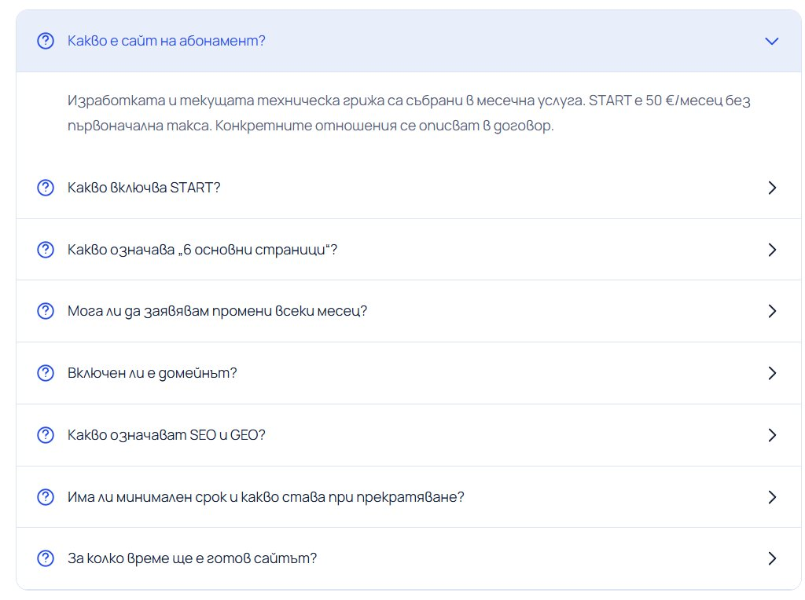

# Преизползваем FAQ компонент

`src/components/faq/faq.tsx` приема данните от страницата и не импортира общия списък с въпроси. Така всяка секция може да показва различно съдържание, без копиране на markup или стилове.

```tsx
import { FAQ } from "@/components/faq/faq";

<FAQ
  label="Въпроси за тази услуга"
  items={[
    {
      id: "service-scope",
      question: "Какво включва услугата?",
      answer: "Тук се задава конкретният отговор за тази страница.",
    },
  ]}
/>;
```

## Данни и поведение

- Типът `FAQItem` в `src/lib/faq.ts` съдържа `id`, `question` и `answer`. Използвайте уникален, постоянен `id` в рамките на списъка. React запазва състоянието на елементите при пренареждане по този id.
- `items` е задължителен readonly списък. Празен списък не изобразява празна рамка. `label` именува секцията за помощни технологии; `className` позволява допълнителен клас за разположение.
- Всеки въпрос се отваря независимо, както в предишния дизайн. Enter и Space активират стандартния button. Въпросът и отговорът са свързани с уникални `aria-controls`/`aria-labelledby`, а състоянието се обозначава с `aria-expanded` и `aria-hidden`.
- Въпросите и отговорите са обикновен текст, който React екранира. Не се приема суров HTML. Съдържанието присъства в server-rendered HTML; клиентският компонент управлява само разгъването.

## Дизайн

Запазени са общите икони и цветовите променливи за двете теми. Всяко заглавие има долна линия, а целият FAQ списък е ограден с рамка. Hover променя фона и цвета на въпроса; клавиатурният фокус остава ясно видим в рамката.

Отговорът се разгъва и прибира чрез CSS Grid от 0fr до 1fr за 320 ms, с плавна прозрачност и завъртане на стрелката. Не се задава фиксирана височина или ограничен max-height, така че дългите отговори и адаптивното пренасяне на текста не се отрязват. Съществуващото правило за `prefers-reduced-motion` премахва преходите.

Параграфите остават 18 px/400. Останалите заглавия в сайта остават 24 px/600. Текстът на бутоните с въпросите запазва досегашния размер 18 px.

Компонентът е използван на началната страница с 4 въпроса, при плановете с 5 и на `/vuprosi` с целия списък. Показаните данни се подават изрично чрез `items`; могат да се заменят с друг списък от същия тип. Няма добавен CMS, административен панел или външна услуга.

## Променени файлове и проверка

- Нови: `src/components/faq/faq.tsx` и `src/lib/faq.ts`.
- Интеграция и данни: `src/components/home/home.tsx`, `src/components/pages/pages.tsx` и `src/lib/content.ts`.
- Стилове: `src/app/globals.css`. Актуализиран е и README с връзка към този документ.

Успешни са `npm run build` и `npm run typecheck`. HTTP проверката потвърди 4/5/8 въпроса на трите страници, отговори в server-rendered HTML и статус 200.

В Chrome са проверени отваряне на няколко отговора, затваряне, Enter/Space, 16 уникални идентификатора за осемте въпроса/панели, външна рамка и долните линии. При ширина 390 px дългият START отговор не прелива или отрязва съдържание; параграфите остават 18 px/400. При емулирано `prefers-reduced-motion: reduce` преходите на отговора и стрелката стават 0 s; след теста настройката е възстановена. Двете теми са прегледани визуално.

Проверките не представляват пълна cross-browser или WCAG сертификация. Локалният сайт остава стартиран за преглед. Няма deployment или промени по хостинг платформата.


